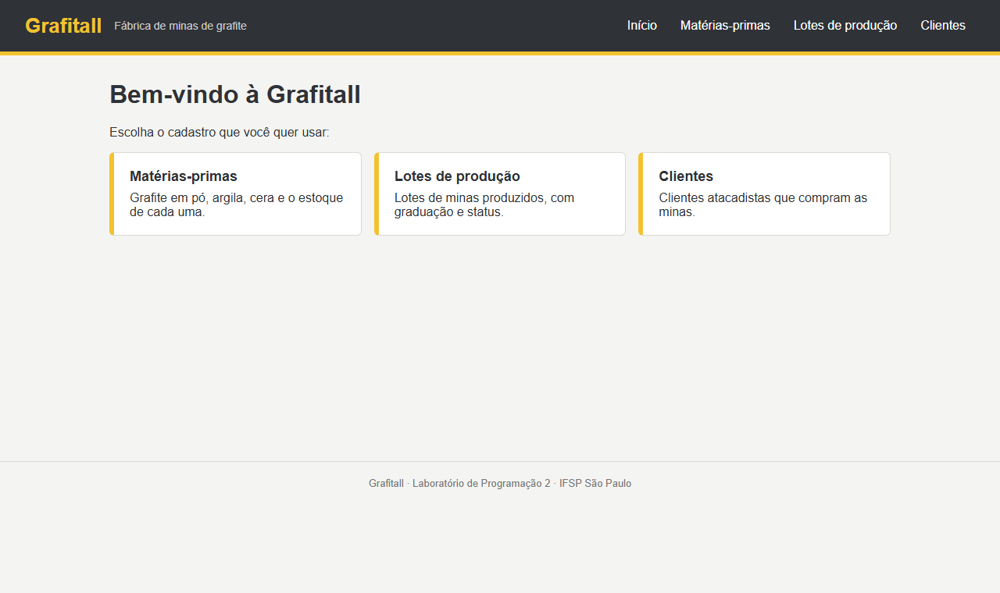
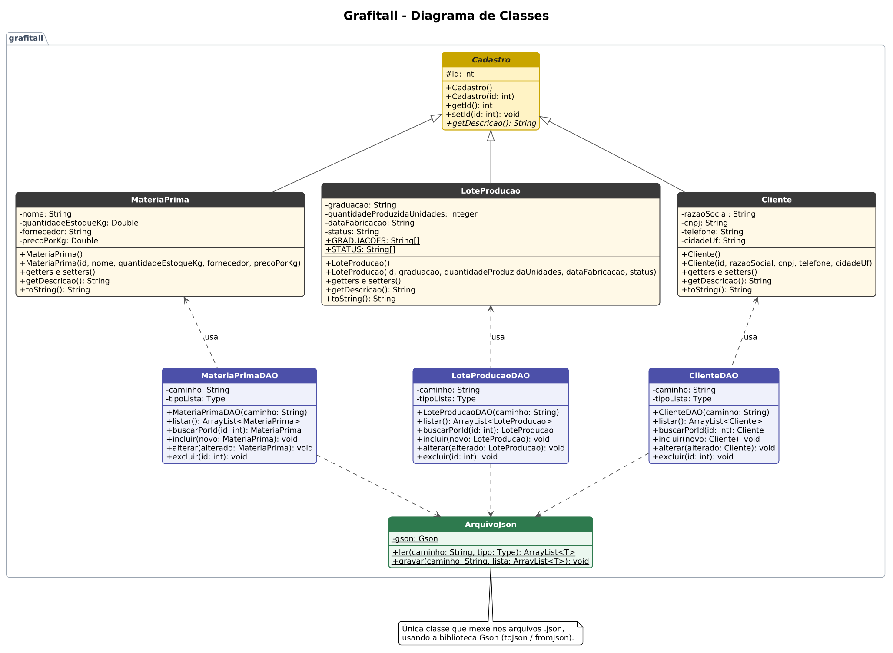
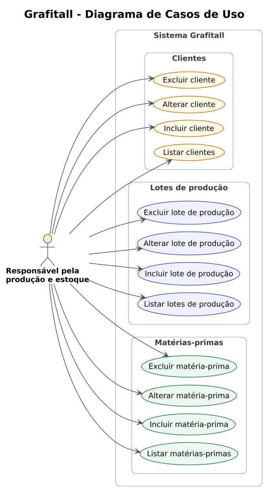
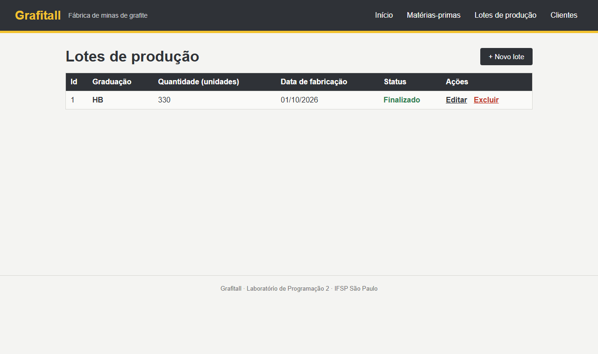
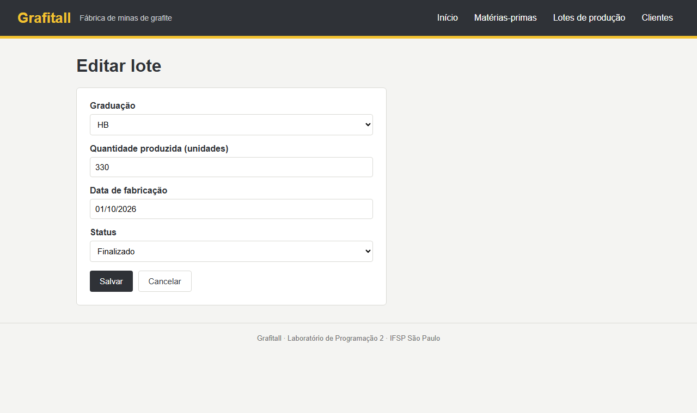
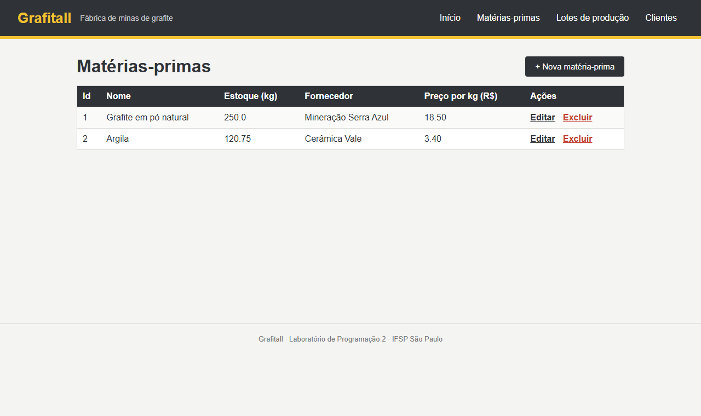
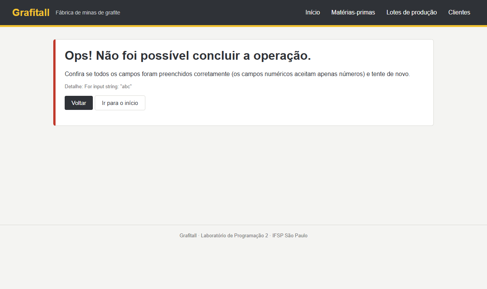

# Grafitall

Sistema web para a **Grafitall**, uma fábrica de minas de grafite para lápis e lapiseiras.
Os responsáveis pela produção e pelo estoque usam o sistema para cadastrar as
matérias-primas, os lotes produzidos e os clientes atacadistas.



## Entidades

| Classe | Atributos (além do `id`) | Arquivo de dados |
|---|---|---|
| `MateriaPrima` | nome, quantidadeEstoqueKg, fornecedor, precoPorKg | `dados/materias-primas.json` |
| `LoteProducao` | graduacao (12H a 12B), quantidadeProduzidaUnidades, dataFabricacao, status | `dados/lotes-producao.json` |
| `Cliente` | razaoSocial, cnpj, telefone, cidadeUf | `dados/clientes.json` |

Cada cadastro tem as operações **incluir, alterar, excluir e listar**.

**Herança:** as três classes herdam da classe abstrata `Cadastro`, que guarda o que é comum
a todas: o `id` (`protected`), `getId()`/`setId()` e o método abstrato `getDescricao()`,
que cada subclasse implementa do seu jeito.

## Tecnologias

- **JSP** (Java Server Pages)
- **Gson 2.11.0**, para ler e gravar o JSON (`toJson` / `fromJson`)
- **JSON**, para guardar os dados (sem banco de dados)
- **Apache Tomcat 9** e **Java 17**

## Diagramas

- Diagrama de classes: [`uml/diagrama-classes.puml`](uml/diagrama-classes.puml)
- Casos de uso: [`casos-de-uso/diagrama-casos-de-uso.puml`](casos-de-uso/diagrama-casos-de-uso.puml)
  e a descrição em [`casos-de-uso/casos-de-uso.md`](casos-de-uso/casos-de-uso.md)

Os diagramas foram escritos em PlantUML (`.puml`); os `.png` são as imagens geradas a partir deles.





## Organização das pastas

```
Grafitall/
├── src/grafitall/          classes Java
│   ├── Cadastro.java           superclasse abstrata (id comum aos três)
│   ├── MateriaPrima.java       modelo (atributos, get/set)
│   ├── LoteProducao.java       modelo
│   ├── Cliente.java            modelo
│   ├── MateriaPrimaDAO.java    incluir / alterar / excluir / listar
│   ├── LoteProducaoDAO.java
│   ├── ClienteDAO.java
│   └── ArquivoJson.java        única classe que lê e grava os .json (Gson)
├── WebContent/
│   ├── WEB-INF/lib/gson-2.11.0.jar
│   ├── dados/                  os três arquivos .json
│   ├── css/estilo.css
│   ├── cabecalho.jsp, rodape.jsp   incluídos em todas as páginas
│   ├── index.jsp               menu inicial
│   ├── erro.jsp                página de erro (isErrorPage="true")
│   └── para cada cadastro (ex.: clientes):
│       clientes.jsp            listagem
│       cliente-form.jsp        formulário único (incluir e alterar)
│       cliente-salvar.jsp      grava e volta para a lista
│       cliente-excluir.jsp     exclui e volta para a lista
├── uml/                    diagrama de classes (.puml e .png)
├── casos-de-uso/           diagrama e descrição dos casos de uso
├── prints/                 telas do sistema funcionando
└── apresentacao/           slides da apresentação
```

## Como rodar no Eclipse (passo a passo)

### Downloads
- [Eclipse IDE for Enterprise Java and Web Developers](https://eclipseide.org/)
- [Apache Tomcat 9](https://tomcat.apache.org/download-90.cgi) (versão Core, zip)
- Java 17 (JDK)

### Configuração
1. Clone este repositório.
2. No Eclipse: **File > New > Dynamic Web Project**.
   - *Project name*: `Grafitall`
   - Desmarque *Use default location* e escolha a pasta do repositório clonado.
   - *Target runtime*: **New Runtime... > Apache Tomcat v9.0** e aponte para a pasta do Tomcat.
   - Clique em **Next** até a tela *Web Module* e troque o *Content directory* para `WebContent`.
   - **Finish**.
3. A Gson já está em `WebContent/WEB-INF/lib`, então o Eclipse a coloca no build path sozinho.
4. Clique com o botão direito no projeto: **Run As > Run on Server > Tomcat v9.0**.
5. Abra `http://localhost:8080/Grafitall/`.

> Ao rodar pelo Eclipse, o Tomcat usa uma cópia do projeto. Os registros salvos
> pelo site ficam nos `.json` dessa cópia, e não na pasta `WebContent/dados` do repositório.

## Telas

| Lotes de produção | Formulário (alterar) |
|---|---|
|  |  |

| Matérias-primas | Página de erro |
|---|---|
|  |  |
